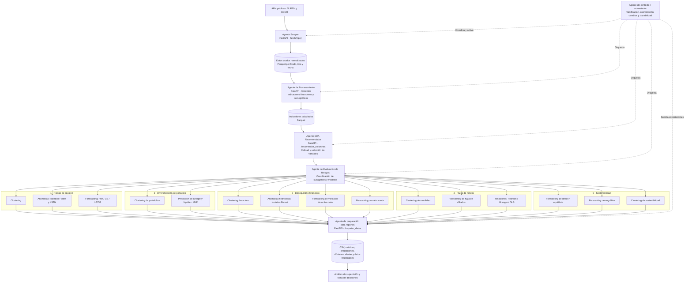
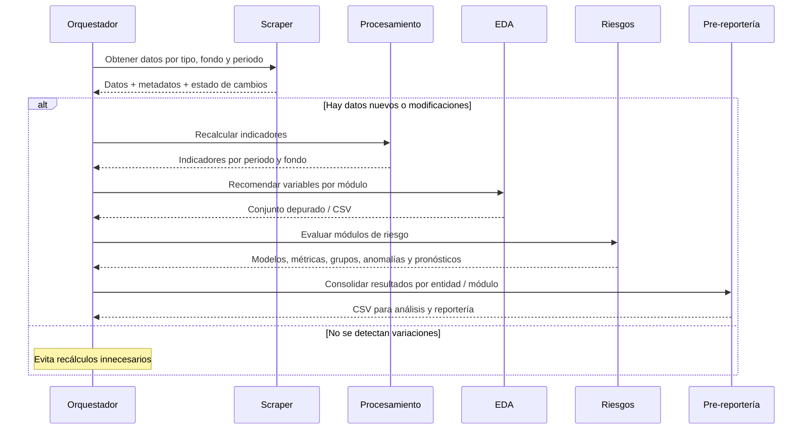

# Resumen técnico integral del sistema multiagente para supervisión previsional

**Documento fuente:** `Agentes_TFM.docx`, *Supervisión Previsional con Sistemas Multiagente: Evaluación de Riesgos en Fondos de Capitalización Individual*, sección «Desarrollo específico de la contribución» y «Resultados de la experimentación».  
**Ámbito:** fondos de capitalización individual; datos públicos de SUPEN y BCCR.  
**Tipo de documento:** síntesis explicativa, técnica y matemática para lectura, mantenimiento y transferencia de conocimiento.  
**Criterio de fidelidad:** los resultados numéricos provienen del documento; las fórmulas matemáticas señaladas como **explicativas** son formulaciones estándar de los métodos para facilitar su comprensión, no una certificación del código implementado. Los puntos inconsistentes del documento se identifican expresamente al final.

## Índice

1. [Visión ejecutiva](#1-visión-ejecutiva)
2. [Diagrama de arquitectura y flujo](#2-diagrama-de-arquitectura-y-flujo)
3. [Catálogo de agentes y responsabilidades](#3-catálogo-de-agentes-y-responsabilidades)
4. [Datos, indicadores y proceso de preparación](#4-datos-indicadores-y-proceso-de-preparación)
5. [Agentes de riesgo: objetivos, modelos y resultados](#5-agentes-de-riesgo-objetivos-modelos-y-resultados)
6. [Fundamentos matemáticos de los modelos](#6-fundamentos-matemáticos-de-los-modelos)
7. [Métricas de evaluación e interpretación](#7-métricas-de-evaluación-e-interpretación)
8. [Cómo interpretar los resultados para supervisión](#8-cómo-interpretar-los-resultados-para-supervisión)
9. [Resultados comparados y decisiones metodológicas](#9-resultados-comparados-y-decisiones-metodológicas)
10. [Limitaciones, contradicciones y verificaciones pendientes](#10-limitaciones-contradicciones-y-verificaciones-pendientes)
11. [Glosario y referencias internas](#11-glosario-y-referencias-internas)

---

## 1. Visión ejecutiva

El trabajo propone una **arquitectura multiagente jerárquica y modular** para analizar riesgos financieros, demográficos y de inversión de los fondos previsionales. En vez de colocar la extracción, las reglas de indicadores y todos los modelos en una sola aplicación, distribuye el proceso entre microservicios con funciones delimitadas, coordinados por un orquestador o **agente de contexto**.

El recorrido general es: **obtener datos oficiales → validarlos y almacenarlos → calcular indicadores → depurar y seleccionar variables → aplicar modelos especializados → preparar resultados para supervisión**. La contribución no consiste en sustituir el juicio del supervisor por una clasificación automática; los resultados se conciben como señales, segmentaciones y proyecciones que aportan evidencia para investigar situaciones relevantes.

El núcleo de evaluación tiene **cinco subagentes de riesgo**:

1. **Riesgo de liquidez:** agrupa perfiles, detecta anomalías temporales y pronostica el activo neto.
2. **Diversificación de portafolio:** segmenta composiciones de inversión y estima indicadores de Sharpe y liquidez mediante redes neuronales.
3. **Desequilibrio financiero:** identifica perfiles financieros, anomalías y proyecciones de variación de activo neto y valor cuota.
4. **Flujos de fondos:** estudia patrones de movilidad de afiliados, pronostica la tasa de fuga y analiza su relación estadística y temporal con rentabilidades y comisiones.
5. **Sostenibilidad:** anticipa desequilibrios financieros y demográficos y agrupa estados de sostenibilidad.

La experimentación se realiza sobre seis entidades: **BACSJ PENSIONES, BCR-PENSION, BN-VITAL, CCSS-OPC, POPULAR y VIDA PLENA**. El documento compara modelos clásicos y de aprendizaje automático, utilizando métricas apropiadas para *clustering*, anomalías y predicción. Sus conclusiones **no establecen un algoritmo ganador para todos los problemas**: la elección depende de la variable objetivo, estabilidad de la serie, capacidad explicativa e interpretabilidad.

> **Alcance:** se resume lo declarado en el documento de tesis. La descripción de un componente como «implementado», «evaluado» o «recomendado» sigue el texto académico; no equivale a verificación independiente de la ejecución o del estado operativo de sus microservicios.

## 2. Diagrama de arquitectura y flujo

### 2.1. Diagrama completo de agentes y módulos

El siguiente diagrama **Mermaid** es texto editable y puede visualizarse en GitHub, en editores Markdown compatibles o mediante una extensión de Mermaid en VS Code.



**Cómo leerlo:** las flechas continuas representan el **flujo lógico de información** y las discontinuas la **coordinación del agente de contexto**. Los quince módulos enumerados en los subagentes se identifican conforme a los apartados de resultados de la experimentación. No se representa una arquitectura de mensajería particular: el documento describe principalmente integración mediante **REST/HTTP**.

### 2.2. Secuencia de operación



**Periodicidad documentada:** el texto describe tanto invocaciones periódicas para obtener datos del mes anterior como un **orquestador preparado para ejecución diaria** (manual o calendarizable). No fija en todos los casos una frecuencia única comprobada en producción.

## 3. Catálogo de agentes y responsabilidades

| Agente | Responsabilidad principal | Entrada | Transformación / técnica | Salida | Componente citado |
|---|---|---|---|---|---|
| **Contexto / orquestador** | Activar agentes, detectar cambios y mantener trazabilidad | Fechas, fondos, disponibilidad y resultados | Reglas de flujo, comparaciones de Parquet, invocación REST | Ejecuciones coordinadas | Script Python con `requests` |
| **Scraper** | Obtener datos públicos | APIs SUPEN/BCCR; fondo y periodo | HTTP, JSON → `pandas`, validaciones | Parquet + metadatos JSON | `api_scraper.py`, `scraper_agente.py`, `SupenDataFetcher` |
| **Procesamiento** | Calcular indicadores de supervisión | Series crudas y normalizadas | Fórmulas estadísticas/financieras, agregaciones | Parquet de indicadores | `api_procesador.py`, `procesador_agente.py`, `ProcesadorIndicadores`, `indicadores/` |
| **EDA Recomendador** | Seleccionar variables aptas para modelar | Series, indicadores y definiciones JSON | Nulos, varianza, outliers, correlaciones | Columnas recomendadas, CSV | `api_eda.py`, `eda_agente.py`, `AgenteEDARecomendador` |
| **Evaluación de Riesgos** | Coordinar modelos especializados | Conjuntos EDA por módulo | Clustering, anomalías, forecasting, análisis estadístico | Predicciones, etiquetas y métricas | Microservicios de evaluación y módulos ML |
| **Preparación de reportes** | Reunir y publicar datos analíticos | Resultados por módulo/entidad/fecha | Transformación a formato tabular | CSV y metadatos de análisis | `api_preparacion_reportes.py`, `preparacion_reportes.py`, `utilidades_transformacion.py` |

### 3.1. Agente de contexto u orquestador

Es el **coordinador operativo**, no el modelo de riesgo: activa cada etapa cuando corresponde, evita recalcular si no hay cambios detectables y permite seguir el origen de los datos hasta los resultados. Según la tesis, **no calcula indicadores ni transforma directamente datos**. Su valor reside en el desacoplamiento de componentes, la secuencia de invocación y la gobernanza del flujo.

**Interpretación de sus resultados:** un flujo completado indica que se ejecutó la cadena prevista; no demuestra por sí solo calidad de datos o validez predictiva. Para ello deben consultarse las validaciones y métricas que produce cada módulo.

### 3.2. Agente Scraper

Consulta **fuentes públicas SUPEN y BCCR**: rentabilidades, comisiones, portafolios, afiliados/aportantes, beneficios, cuentas/activo neto y tasas de referencia. Su servicio FastAPI expone `/fetch/{tipo}`; permite parametrizar fondo, inicio y fin, devolver información estructurada y decidir si persiste resultados. Los datos pasan a `DataFrame` y se almacenan en **Apache Parquet**, organizado de forma jerárquica:

```text
data/{fondo}/{tipo}/{año}/{mes}/{día}/data.parquet
```

**Controles descritos:** estructura JSON válida, columnas esenciales, fechas, tipos numéricos, nulos y comparación de nuevas descargas con datos persistidos. **Interpretación:** detectar datos cambiados habilita un nuevo ciclo de cálculo; no debe confundirse con la detección de una anomalía financiera.

### 3.3. Agente de Procesamiento

Implementa `/procesar`, trabaja por **entidad, fondo y rango temporal**, calcula indicadores en módulos especializados y conserva los resultados en Parquet. Separa extracción de cálculo y permite reproducir las series que emplean los modelos.

Los resultados son **medidas descriptivas y de riesgo**, no predicciones en sí mismas: por ejemplo, un índice de diversificación bajo describe concentración; un pronóstico de ese índice corresponde a otro módulo analítico.

### 3.4. Agente EDA Recomendador

Usa `/recomendar_columnas` con una definición JSON de series e indicadores, carpetas de datos, fechas, subagente y módulo. Estandariza y filtra entradas para los modelos. Aplica porcentaje de nulos, varianza mínima, detección adaptativa de atípicos (z-score o IQR), correlación de Pearson y control de multicolinealidad; documenta además eliminación de duplicados. Puede exportar recomendaciones y pasos intermedios a CSV.

**Interpretación:** una columna excluida por correlación alta puede ser redundante para un modelo, pero no deja de ser relevante para supervisión. Un valor extremo puede representar un error de calidad o una señal genuina de riesgo; su eliminación debe justificarse según el objetivo analítico.

### 3.5. Agente de preparación para reportes

Utiliza `/exportar_datos` y la función `exportar_resultados_csv` para consolidar salidas en **CSV**, manteniendo información por subagente, módulo, entidad/fondo y periodo. Puede contener etiquetas de grupos, banderas de anomalía, métricas y predicciones. El objetivo no es calcular riesgos nuevos, sino permitir su reutilización en **Excel, Power BI o análisis posteriores**. La tesis describe un agente de **pre-reportería**, no una implementación comprobada de paneles o decisiones regulatorias automáticas.

## 4. Datos, indicadores y proceso de preparación

### 4.1. Familias de información

| Familia | Ejemplos | Utilidad supervisora |
|---|---|---|
| **Rentabilidad y valor cuota** | Rentabilidades, valor cuota, volatilidad | Desempeño y variaciones del fondo |
| **Inversiones** | Composición del portafolio, monedas, emisores, modalidades | Concentración, diversificación y liquidez |
| **Afiliados** | Afiliados, aportantes, crecimiento, libre transferencia | Captación, fuga y comportamiento demográfico |
| **Beneficios** | Beneficiarios, pensionados, pagos y promedios | Presiones de egreso y madurez previsional |
| **Finanzas** | Activo neto, cuentas, comisiones | Equilibrio de recursos y costos |
| **Mercado** | Curvas soberanas y tasas del BCCR | Tasas de referencia y métricas ajustadas por riesgo |

### 4.2. Indicadores relevantes

La tesis se refiere a los anexos para la definición exhaustiva de fórmulas. Entre los indicadores que aparecen expresamente en los análisis figuran **rentabilidad**, **variación del activo neto**, **índice de equilibrio financiero**, **ratio de Sharpe**, **índice de liquidez**, **concentración de activos**, **diversificación de Shannon**, **tasa de fuga**, **flujo neto de afiliados**, **crecimiento de aportantes y pensionados** y **carga administrativa**.

A modo de orientación matemática, sin sustituir la ficha exacta del indicador del anexo:

- **Rentabilidad simple:** $R_t=(V_t-V_{t-1})/V_{t-1}$; el significado de $V$ depende de la serie utilizada, frecuentemente valor cuota.
- **Variación relativa de activo neto:** $\Delta AN_t=(AN_t-AN_{t-1})/AN_{t-1}$, si la definición adoptada es porcentual.
- **Concentración máxima:** $C=\max_i(w_i)$, con $w_i$ participación del activo $i$.
- **Diversificación de Shannon:** $H=-\sum_i w_i\log w_i$; crece con la distribución más uniforme de inversiones.
- **Ratio de Sharpe:** $S=(\overline R_p-R_f)/\sigma_p$, sujeto a periodos y unidades consistentes.
- **Indicador de liquidez:** proporción de activos definidos como líquidos respecto del portafolio considerado; requiere un criterio explícito para clasificar «líquido».
- **Tasa de fuga:** salidas de afiliados durante el periodo divididas por la población de referencia definida para el indicador.

**Importante:** estas expresiones son ayudas didácticas y no certifican denominadores, ventanas ni umbrales implementados. Para reproducir resultados hay que utilizar las fichas del **Anexo B**, el código de `indicadores/` y los datos del estudio.

### 4.3. Cálculos básicos del EDA

**Porcentaje de nulos de una variable $j$:**

$$p_{null,j}=100\frac{\#\{x_{ij}\ \text{faltante}\}}{n}$$

**Varianza muestral:**

$$s_j^2=\frac{1}{n-1}\sum_{i=1}^{n}(x_{ij}-\bar{x}_j)^2$$

**Z-score** para distribución apropiadamente aproximada por normal:

$$z_i=\frac{x_i-\bar{x}}{s}$$

**Rango intercuartílico:**

$$IQR=Q_3-Q_1,\qquad x<Q_1-1.5\,IQR\ \text{o}\ x>Q_3+1.5\,IQR$$

**Correlación de Pearson:**

$$r_{XY}=\frac{\sum_i(x_i-\bar{x})(y_i-\bar{y})}{\sqrt{\sum_i(x_i-\bar{x})^2\sum_i(y_i-\bar{y})^2}}$$

**Lectura:** altas proporciones de nulos, baja varianza y redundancia pueden reducir la utilidad de las variables, pero la selección debe considerar la capacidad predictiva y el significado económico. El EDA no establece causalidad entre variables.

## 5. Agentes de riesgo: objetivos, modelos y resultados

### 5.1. Riesgo de liquidez

**Pregunta supervisora:** ¿el fondo dispone de una composición financiera y una trayectoria de activo neto que permitan reconocer situaciones de tensión o comportamientos atípicos?

#### 5.1.1. Clustering de riesgo de liquidez

Se compararon **K-Means, Gaussian Mixture Models (GMM), DBSCAN y clustering jerárquico**, con evaluación basada en *Silhouette*, *Calinski-Harabasz* y *Davies-Bouldin*, además de una puntuación combinada normalizada.

**Resultados destacados del documento:**

| Configuración | Resultado reportado | Interpretación |
|---|---|---|
| K-Means, **k=2**, split 5 | Silhouette **0.296312**; Calinski-Harabasz **295.0695**; Davies-Bouldin **1.6224**; score combinado **0.8338** (tabla 6) | La mejor puntuación del ranking mostrado de validación cruzada |
| K-Means, **k=2** | Score de entrenamiento **0.8491**; validación **0.8764** (tabla 7) | Configuración estable en esa comparación |
| GMM, **k=2** | Entrenamiento **0.7741**; validación **0.7046** | Alternativa competitiva pero inferior |
| K-Means, **k=4** | Entrenamiento **0.8337**; validación **0.5125** | Caída importante, posible sensibilidad a particiones |
| DBSCAN | Sensibilidad a `eps` y casos de Silhouette negativo | Mayor dificultad de calibración y estabilidad |

**Interpretación para supervisión:** los grupos pueden servir para comparar perfiles de liquidez, pero **el número de clúster no equivale automáticamente a un nivel de riesgo**. Es necesario examinar las características financieras de cada grupo. Los puntajes de agrupamiento describen estructura interna, no una tasa de acierto supervisada.

#### 5.1.2. Detección de anomalías de liquidez

Se investigaron **Isolation Forest clásico**, **Isolation Forest con ventanas deslizantes** y dos variantes de **LSTM**: *autoencoder* y *predictor*.

- **Isolation Forest:** inicialmente marcó demasiadas observaciones como atípicas en validación y prueba. Se ajustó `contamination` por entidad y se limitó a un **máximo del 20 %**, pero persistió la inestabilidad.
- **Rolling window:** pretendía adaptar la estimación a cambios temporales, pero también mostró comportamiento irregular y sensibles cambios entre particiones.
- **Prueba de Kolmogorov–Smirnov (KS):** las diferencias pronunciadas entre distribuciones de entrenamiento y prueba, incluidos estadísticos cercanos a 1 en algunas comparaciones, apoyaron la hipótesis de **deriva temporal de datos**.
- **LSTM autoencoder:** aprende a reconstruir patrones temporales normales y marca desviaciones mediante error de reconstrucción.
- **LSTM predictor:** anticipa la siguiente observación o secuencia y estima anomalías mediante error de predicción; tuvo resultados más variables.

En la comparación del texto, el **LSTM autoencoder obtuvo menor MSE en cinco de las seis entidades**, mientras que el predictor fue relativamente más favorable en **VIDA PLENA**. El documento también destaca configuraciones con `dropout≈0.2`, `batch_size≈8` y regularización `L2≈0.0001` en varias entidades, sin afirmar que sean universales.

**Interpretación:** un error alto de reconstrucción señala una **desviación frente al patrón aprendido**, no demuestra fraude, incumplimiento o insolvencia. La conclusión metodológica del módulo favorece el LSTM autoencoder respecto de Isolation Forest para las series temporales multivariadas examinadas.

#### 5.1.3. Forecasting de liquidez del activo neto

Compara **Holt-Winters, Gradient Boosting Regressor y LSTM** para proyectar el activo neto.

| Entidad | R² LSTM reportado (tabla 20) | Lectura |
|---|---:|---|
| BACSJ PENSIONES | 0.8110 | Mayor capacidad explicativa relativa frente al modelo multivariado comparado |
| BCR-PENSION | 0.7775 | Ajuste positivo, no perfecto |
| BN-VITAL | 0.7731 | Ajuste positivo |
| CCSS-OPC | 0.6884 | Ajuste inferior al resto de la mayoría de entidades |
| POPULAR | 0.9407 | Mejor R² del conjunto |
| VIDA PLENA | 0.8949 | Ajuste alto |

**Balance del documento:** LSTM muestra ventaja en capacidad explicativa; **Holt-Winters** ofrece proyecciones más suaves, sencillas y explicables y se recomienda como **línea base operativa**. Gradient Boosting es útil para comparación, aunque se reportan resultados menos consistentes.

**Advertencia interpretativa:** R² favorable en un conjunto de prueba no asegura una trayectoria futura realista. La tesis advierte que ciertas extrapolaciones de LSTM pueden ser demasiado pronunciadas y que se debe vigilar su plausibilidad financiera.

### 5.2. Diversificación de portafolio

**Pregunta supervisora:** ¿qué tan concentradas están las inversiones y cómo se relacionan la estructura del portafolio, la liquidez y la rentabilidad ajustada por riesgo?

#### 5.2.1. Análisis de diversificación mediante clustering

Aplica **K-Means, jerárquico, GMM y DBSCAN** sobre variables como concentración, índice de Shannon y liquidez. El documento destaca modelos **K-Means k=4 y k=5**, y **jerárquico k=4**, con puntuaciones combinadas cercanas a **0.95** en el ranking descrito; además observa estabilidad en algunas configuraciones jerárquicas con **k=2** y K-Means **k=3**.

**Interpretación:** las agrupaciones revelan **semejanzas estructurales** entre portafolios, útiles para comparación y detección de concentración. No hay equivalencia automática «clúster 0 = riesgo bajo» sin interpretar sus centroides, distribuciones de indicadores y condiciones del fondo.

#### 5.2.2. Optimización de portafolios líquidos: MLP

El módulo utiliza una **red neuronal multicapa (MLP)** para predecir dos objetivos: **ratio de Sharpe** e **índice de liquidez**. Se evalúa mediante **MSE, R²** y proporción de predicciones dentro de una banda de **±10 %** del valor observado.

| Entidad | R² Sharpe | R² Liquidez | Observación del estudio (tabla 21) |
|---|---:|---:|---|
| BACSJ PENSIONES | 0.9601 | 0.9527 | Buen rendimiento de ambos objetivos |
| BCR-PENSION | 0.9847 | **−0.5268** | El pronóstico de liquidez no generaliza adecuadamente |
| BN-VITAL | 0.9777 | 0.8357 | Mejor ajuste para Sharpe |
| CCSS-OPC | 0.9920 | 0.9789 | Ajuste alto en ambas tareas |
| POPULAR | 0.9899 | 0.9253 | Mejor ajuste para Sharpe |
| VIDA PLENA | **0.9967** | 0.8835 | Mejor R² de Sharpe |

La tesis informa además una **precisión relativa del 84.62 %** para Sharpe en VIDA PLENA y **67.31 %** para liquidez en CCSS-OPC.

**Interpretación:** un MLP que predice bien Sharpe no necesariamente predice bien la liquidez: son **variables objetivo distintas**. El R² negativo de BCR-PENSION en liquidez alerta sobre un desempeño inferior a predecir por la media en la evaluación considerada. Los buenos resultados no constituyen por sí solos una optimización de pesos del portafolio ni una recomendación automática de inversión.

### 5.3. Desequilibrio financiero

**Pregunta supervisora:** ¿existen patrones de tensión, desviaciones inusuales o deterioros previsibles del activo neto y del valor cuota?

#### 5.3.1. Clustering de riesgo financiero

Compara **K-Means, GMM, DBSCAN y jerárquico** con métricas internas de clustering. El resultado destacado es **jerárquico con k=2**, con **score combinado 0.9695** en el mejor split de la tabla 22 y, en la comparación posterior de la tabla 23, **0.9695 en entrenamiento y 0.9891 en prueba**. **K-Means k=3** presenta **0.8727 / 0.8833** respectivamente.

**Interpretación:** la solución jerárquica con dos grupos muestra una segmentación relativamente estable para las variables seleccionadas. Los grupos permiten comparar perfiles, pero la palabra «desequilibrio» requiere examinar indicadores financieros reales y el momento temporal.

#### 5.3.2. Detección de anomalías financieras

Utiliza **Isolation Forest clásico** y **rolling window** sobre variables como **tasas de crecimiento de aportantes, pensionados y rentabilidad**. El modelo clásico identificó pocas anomalías; el enfoque temporal detectó desviaciones locales con mayor sensibilidad.

Se empleó **KS** para contrastar distribuciones de entrenamiento y prueba, observándose fluctuaciones especialmente relevantes en los análisis de **POPULAR** y **VIDA PLENA** en varios splits. La tesis describe aumentos del estadístico KS y deterioro de scores a partir de determinadas divisiones temporales.

**Interpretación:** la variante temporal es más sensible a cambios de régimen, pero un incremento de detecciones no debe presentarse automáticamente como mayor exactitud. Es necesario contrastar la estabilidad, el contexto y los falsos positivos.

#### 5.3.3. Forecasting de variación del activo neto

Compara **Holt-Winters, Gradient Boosting y LSTM** con MSE y R². La tabla 24 señala los siguientes R² de LSTM:

| Entidad | R² LSTM, tabla 24 |
|---|---:|
| BACSJ PENSIONES | 0.9458 |
| BCR-PENSION | 0.9611 |
| BN-VITAL | 0.7835 |
| CCSS-OPC | 0.9530 |
| POPULAR | **0.2212** |
| VIDA PLENA | 0.8977 |

**Lectura:** el ajuste varía de manera importante entre entidades. En particular, POPULAR evidencia una limitación clara en esta tabla; **no sería correcto afirmar que el modelo explica la variación de todas las entidades con la misma solidez**.

#### 5.3.4. Forecasting de valor cuota

La comparación de la **tabla 25** también incluye **Gradient Boosting, LSTM y Holt-Winters**. La narrativa y los R² de esa tabla favorecen LSTM en las seis entidades: **0.8735, 0.8805, 0.8154, 0.9461, 0.8586 y 0.9165**, respectivamente para BACSJ, BCR, BN-VITAL, CCSS-OPC, POPULAR y VIDA PLENA. Gradient Boosting presenta R² negativos o muy bajos en varios casos.

**Interpretación:** el valor cuota muestra dependencias temporales que LSTM modeló mejor en el experimento. Holt-Winters se conserva como referencia interpretable. La tesis menciona posibles problemas de escalado y de incorporación de estructura temporal para explicar resultados bajos de los demás modelos.

### 5.4. Flujos de fondos

**Pregunta supervisora:** ¿cómo se comporta la movilidad de afiliados?, ¿puede anticiparse la tasa de fuga? y ¿qué relaciones existen entre rentabilidad, comisiones y transferencias?

#### 5.4.1. Clustering de flujos de afiliados

Se compararon **jerárquico, K-Means, GMM y DBSCAN**. La configuración preferida fue el **clustering jerárquico aglomerativo k=2**, con:

- **Silhouette:** 0.5279.
- **Calinski-Harabasz:** 345.4815.
- **Davies-Bouldin:** 0.6797.
- **Score combinado de entrenamiento:** 0.9238.
- **Score combinado de validación:** 0.8651.

La validación se describe mediante bloques temporales / **TimeSeriesSplit**.

**Interpretación:** permite reconocer dinámicas semejantes de entradas y salidas de afiliados. La estabilidad entre entrenamiento y validación respalda su utilidad como segmentación, pero los clústeres requieren caracterización para saber qué patrón de flujos representan.

#### 5.4.2. Forecasting de la tasa de fuga de afiliados

Compara **Holt-Winters, LSTM y Gradient Boosting**. En la tabla 29, Gradient Boosting presenta el menor MSE para BACSJ, BCR, BN-VITAL, POPULAR y VIDA PLENA; en CCSS los errores mostrados están redondeados al mismo valor. El R² de Gradient Boosting por entidad es:

| Entidad | R² Gradient Boosting (tabla 29) | R² LSTM |
|---|---:|---:|
| BACSJ PENSIONES | **0.6880** | 0.3497 |
| BCR-PENSION | **0.6359** | 0.3343 |
| BN-VITAL | **0.4445** | 0.4073 |
| CCSS-OPC | **0.4915** | 0.4064 |
| POPULAR | **0.6331** | 0.4977 |
| VIDA PLENA | **0.4553** | 0.3507 |

**Interpretación:** en este problema **Gradient Boosting** obtuvo resultados más favorables en la tabla, siempre condicionados a la calidad y disponibilidad de las variables explicativas. LSTM ofrece una alternativa secuencial y Holt-Winters aporta una referencia simple. Los R², en general, son moderados: los pronósticos deben interpretarse como **señales probabilísticas/estimaciones** y no como certeza de fuga.

#### 5.4.3. Relación entre rentabilidad y flujos

Se utilizaron tres técnicas complementarias:

1. **Correlación de Pearson:** identifica asociaciones lineales contemporáneas, sin establecer causalidad.
2. **Causalidad de Granger:** verifica si los rezagos de una serie mejoran la predicción de otra (hasta **tres meses** según el documento); es predictibilidad temporal, **no causalidad económica demostrada**.
3. **Regresión lineal múltiple (OLS):** estima poder explicativo conjunto y relaciones condicionales entre variables.

**Resultados destacados del texto:**

- Asociación negativa entre `comision_saldo` y `valor_cuota_promedio` en las entidades analizadas.
- Correlaciones relevantes entre rentabilidad y captación en **CCSS-OPC**, y relaciones entre flujos y valor cuota en **VIDA PLENA** y **BCR-PENSION**.
- Evidencia predictiva temporal en la dirección **`rango_mensual_valorcuota` → `comision_saldo`** con rezago de **un mes**, según la interpretación presentada del análisis de Granger.
- En OLS, **R² ajustado global ≈0.796** para `valor_cuota_promedio` y **≈0.7237** para `comision_saldo`.
- Algunas variables objetivo, como `tasa_crecimiento_rentabilidad`, `sharpe_ratio` y `flujo_neto_afiliados_fondos`, mostraron bajo ajuste con las entradas consideradas.

**Interpretación:** la dirección de Granger y las correlaciones son señales útiles para formular hipótesis y seleccionar variables, pero pueden depender de rezagos, autocorrelación, estacionalidad, tendencias comunes y factores no observados. No debe afirmarse que una modificación de comisiones **cause** mecánicamente una variación de valor cuota a partir de estas pruebas.

### 5.5. Sostenibilidad

**Pregunta supervisora:** ¿qué tendencias financieras y demográficas podrían anticipar tensiones persistentes y cómo evoluciona el perfil de cada entidad?

#### 5.5.1. Forecasting de déficit / equilibrio financiero

Se emplearon **Holt-Winters, Gradient Boosting y LSTM** para la trayectoria del **índice de equilibrio financiero**. El texto destaca ventajas de LSTM y de Holt-Winters, pero **la tabla 30 no coincide con la conclusión narrativa**: en cuatro de las seis entidades, el MSE reportado de Gradient Boosting es menor que el de LSTM, mientras que su R² es mayor en las seis. Por ello, **no se fija aquí un ganador definitivo sin una reconciliación de resultados**.

| Entidad | MSE GB | R² GB | MSE LSTM | R² LSTM | MSE HW |
|---|---:|---:|---:|---:|---:|
| BACSJ PENSIONES | 5.26 | 0.46 | 4.34 | 0.38 | 13.05 |
| BCR-PENSION | 3.58 | 0.45 | 2.53 | 0.32 | 11.16 |
| BN-VITAL | 1.40 | 0.76 | 2.19 | 0.42 | 5.14 |
| CCSS-OPC | 1.84 | 0.76 | 3.43 | 0.15 | 6.61 |
| POPULAR | 1.03 | 0.69 | 1.82 | 0.23 | 3.19 |
| VIDA PLENA | 2.27 | 0.65 | 2.87 | 0.49 | 4.62 |

**Nota de fidelidad:** en BACSJ y BCR, el MSE de LSTM **sí es menor** que el de GB; por tanto, GB supera a LSTM en MSE en **cuatro de seis** entidades, pero tiene R² mayor en **seis de seis**. La contradicción de fondo es que el texto afirma superioridad global de LSTM y ofrece cifras de R² distintas de la tabla. Se reproduce la tabla, sin recalcular modelos ni resolver arbitrariamente la discrepancia.

**Interpretación:** incluso si se resolviera qué modelo tuvo menor error, el índice se plantea como una **señal estructural de tensión**; no basta una predicción puntual para diagnosticar sostenibilidad de largo plazo. El documento propone Holt-Winters como línea base transparente y modelos más complejos como complemento analítico.

#### 5.5.2. Forecasting demográfico

Compara **Holt-Winters, Gradient Boosting y LSTM** para anticipar dinámicas de afiliación y envejecimiento. La tabla 31 muestra resultados heterogéneos:

| Entidad | Resultado destacado de tabla 31 | Interpretación |
|---|---|---|
| BACSJ PENSIONES | GB R² **0.63** | Mejor R² y RMSE entre los tres enfoques |
| BCR-PENSION | GB R² **0.73** | Mejor R² y RMSE |
| BN-VITAL | LSTM R² **0.66**; HW menor RMSE **1242.19** | Mejor forma explicativa no equivale al menor error absoluto |
| CCSS-OPC | HW RMSE **319.83** | Mejor precisión absoluta entre comparados |
| POPULAR | HW RMSE **2907.43**; GB R² **−1.01** | Dificultad predictiva y mal ajuste de GB |
| VIDA PLENA | GB R² **0.78** | Mejor R² y RMSE |

**Interpretación:** no existe un ganador uniforme. **Holt-Winters** es útil como base interpretable; **Gradient Boosting** aprovecha estructuras no lineales y covariables; **LSTM** puede capturar dependencias complejas, pero sus ventajas dependen de la entidad y serie.

#### 5.5.3. Clustering de sostenibilidad

Agrupa observaciones históricas normalizadas en **cuatro perfiles (C0–C3)**, descritos mediante un *heatmap* que integra indicadores financieros, demográficos, de rentabilidad, diversificación y costos.

| Clúster | Interpretación reportada |
|---|---|
| **C0** | Desempeño limitado: menor rentabilidad, diversificación y sostenibilidad |
| **C1** | Perfil favorable: rentabilidad elevada y eficiencia administrativa |
| **C2** | Madurez institucional: activos altos y sostenibilidad media-alta |
| **C3** | Presiones estructurales: mayor carga administrativa y proporción de pensionados |

**Trayectorias cualitativas del texto:** BN-VITAL pasa de C0 a C3 con estados intermedios; BACSJ PENSIONES aparece en los cuatro clústeres en diferentes periodos; CCSS-OPC se concentra predominantemente en C2.

**Interpretación:** el valor mayor está en observar **transiciones temporales entre estados**. C0–C3 son **etiquetas de una partición estadística**, no categorías regulatorias oficiales ni equivalentes garantizados a grados ordinales de riesgo.

## 6. Fundamentos matemáticos de los modelos

> Las ecuaciones de esta sección son **explicaciones matemáticas estándar** para entender las técnicas mencionadas en la tesis. Cuando el documento no informa hiperparámetros o variantes concretas, no se atribuye a su implementación una especificación matemática más restrictiva de la que consta en la fuente.

### 6.1. K-Means

Divide $n$ observaciones $x_i$ en $k$ grupos, minimizando la dispersión respecto a los centroides $\mu_j$:

$$\min_{C_1,\dots,C_k}\sum_{j=1}^{k}\sum_{x_i\in C_j}\|x_i-\mu_j\|_2^2$$

Cada observación se asigna al centroide más cercano, se recalculan centroides y se repite hasta converger. **Interpretación:** agrupa perfiles similares; es sensible a escalado y selección de $k$. Se usa en liquidez, diversificación y perfiles financieros.

### 6.2. Clustering jerárquico aglomerativo

Comienza con observaciones individuales y va fusionando grupos según una medida de distancia y un criterio de enlace. Un **ejemplo** de enlace Ward minimiza el aumento de suma de cuadrados:

$$\Delta(A,B)=\frac{|A|\,|B|}{|A|+|B|}\|\mu_A-\mu_B\|_2^2$$

La tesis **no confirma un único criterio de enlace para todos los módulos**; por eso la ecuación de Ward es ilustrativa. La técnica fue particularmente favorable en riesgo financiero y flujos.

### 6.3. Gaussian Mixture Models (GMM)

Representa la densidad de los datos como suma ponderada de distribuciones gaussianas:

$$p(x)=\sum_{j=1}^{k}\pi_j\,\mathcal N(x\mid\mu_j,\Sigma_j),\qquad \pi_j\ge0,\quad\sum_j\pi_j=1$$

A diferencia de K-Means, produce **probabilidades de pertenencia** a los grupos. Es útil cuando hay superposición de perfiles, aunque la estimación de covarianzas puede introducir sensibilidad.

### 6.4. DBSCAN

Define vecindarios de radio $\varepsilon$:

$$N_\varepsilon(x_i)=\{x_j:\ d(x_i,x_j)\le\varepsilon\}$$

Una observación es central si su vecindario alcanza `min_samples`. Los grupos se forman por conectividad de densidad y algunos puntos quedan etiquetados como ruido. La tesis muestra sensibilidad del resultado a `eps`, especialmente en análisis de liquidez.

### 6.5. Isolation Forest

Construye árboles aleatorios; las anomalías suelen quedar aisladas con **trayectorias más cortas**. Una puntuación clásica es:

$$s(x,n)=2^{-\frac{E[h(x)]}{c(n)}}$$

con $h(x)$ longitud de ruta y $c(n)$ factor de normalización. **La implementación de scikit-learn también ofrece** `decision_function`, cuya interpretación de signo depende de su umbral: valores menores que cero suelen marcar observaciones atípicas. `contamination` ayuda a calibrar la proporción esperada. En la tesis, el rendimiento mostró problemas cuando las observaciones dependían fuertemente del tiempo.

### 6.6. LSTM: memoria de secuencias

Una celda LSTM mantiene un estado $c_t$ y un estado oculto $h_t$ controlados por compuertas. Una formulación estándar es:

$$f_t=\sigma(W_f[h_{t-1},x_t]+b_f)$$
$$i_t=\sigma(W_i[h_{t-1},x_t]+b_i)$$
$$\tilde c_t=\tanh(W_c[h_{t-1},x_t]+b_c)$$
$$c_t=f_t\odot c_{t-1}+i_t\odot\tilde c_t$$
$$o_t=\sigma(W_o[h_{t-1},x_t]+b_o),\qquad h_t=o_t\odot\tanh(c_t)$$

$f_t$ decide cuánto recordar, $i_t$ cuánto incorporar y $o_t$ cuánto exponer. Por eso LSTM resulta apropiada para dependencias temporales largas.

**Dos usos distintos en la tesis:**

- **LSTM predictor:** aprende $\hat{x}_{t+1}=f_\theta(x_{t-w+1},\ldots,x_t)$. La anomalía se aproxima por el error de pronóstico.
- **LSTM autoencoder:** obtiene $\hat X=g_\theta(f_\theta(X))$ y minimiza el error de reconstrucción de la secuencia. Un ejemplo de medida es:

$$E(X)=\frac{1}{w\,p}\sum_{t=1}^{w}\sum_{j=1}^{p}(X_{tj}-\hat X_{tj})^2$$

Un error elevado sugiere una secuencia menos parecida a las aprendidas. **No identifica por sí mismo la causa económica** de la anomalía.

### 6.7. Holt-Winters (suavizamiento exponencial)

Modela componentes de **nivel, tendencia y, si aplica, estacionalidad**. Una forma aditiva ilustrativa es:

$$\ell_t=\alpha(y_t-s_{t-m})+(1-\alpha)(\ell_{t-1}+b_{t-1})$$
$$b_t=\beta(\ell_t-\ell_{t-1})+(1-\beta)b_{t-1}$$
$$s_t=\gamma(y_t-\ell_t)+(1-\gamma)s_{t-m}$$
$$\widehat y_{t+h}=\ell_t+h\,b_t+s_{t-m+((h-1)\bmod m)+1}$$

Con $m$ como periodo estacional y $\alpha,\beta,\gamma$ parámetros de suavizamiento. El texto no especifica universalmente si utiliza la variante aditiva, multiplicativa o sin estacionalidad. **Ventaja:** estabilidad, rapidez y facilidad de comunicación. **Límite:** puede subestimar cambios abruptos.

### 6.8. Gradient Boosting Regressor

Construye un modelo aditivo de árboles débiles, corrigiendo iterativamente errores:

$$\widehat y(x)=F_M(x)=F_0(x)+\nu\sum_{m=1}^{M}h_m(x)$$

Aquí $h_m$ representa un árbol añadido en una etapa y $\nu$ la tasa de aprendizaje. Con pérdida cuadrática, cada etapa se aproxima a los residuos del modelo previo. **Ventaja:** captura no linealidades y covariables. **Riesgo:** sin rezagos o variables temporales diseñadas apropiadamente puede no representar bien una secuencia.

### 6.9. Perceptrón multicapa (MLP)

Cada capa aplica una transformación afín seguida de una función no lineal:

$$a^{(\ell)}=\phi\!\left(W^{(\ell)}a^{(\ell-1)}+b^{(\ell)}\right)$$

La salida estima una variable objetivo continua, como Sharpe o liquidez. Con MSE, el entrenamiento minimiza:

$$\mathcal L(\theta)=\frac1n\sum_{i=1}^n(y_i-\hat y_i)^2$$

Los R² muy altos de Sharpe deben entenderse **para ese objetivo y conjunto evaluado**, no extrapolarse automáticamente a la liquidez.

### 6.10. Modelos adicionales del marco metodológico

La parte teórica menciona asimismo **ARIMA, regresión logística, regresión lineal, Random Forest, XGBoost, PCA y modelos autoencoder**, además de técnicas de clasificación y regresión. No todos aparecen como modelos experimentales principales en cada subagente.

- **ARIMA(p,d,q):** tras diferenciar $d$ veces, combina términos autorregresivos y medias móviles: $\phi(B)(1-B)^d y_t=\theta(B)\varepsilon_t$, donde $B$ es el operador de rezago.
- **Regresión logística:** $P(y=1\mid x)=1/(1+e^{-(\beta_0+\beta^Tx)})$, útil para clasificación binaria con etiquetas.
- **Random Forest:** combina predicciones de múltiples árboles entrenados sobre muestras y subconjuntos de variables.
- **XGBoost:** boosting de árboles con regularización para predicción supervisada.
- **PCA:** proyecta $X$ sobre direcciones de máxima varianza $Z=XW$, después de centrar y, según las variables, escalar los datos.

Estos métodos son **opciones de la arquitectura de modelado**; no deben presentarse como ganadores de un experimento en el que el documento no reporta sus métricas.

### 6.11. Pearson, regresión OLS y Granger

**Regresión lineal multivariante (OLS):**

$$y=X\beta+\varepsilon,\qquad\widehat\beta=(X^TX)^{-1}X^Ty$$

La forma cerrada supone que $X^TX$ es invertible; en la práctica se emplean métodos numéricamente estables. El **R² ajustado** penaliza la inclusión de predictores sin beneficio suficiente:

$$R^2_{adj}=1-(1-R^2)\frac{n-1}{n-p-1}$$

**Granger:** contrasta un modelo autorregresivo restringido con uno que incorpora rezagos de otra variable:

$$Y_t=\alpha_0+\sum_{i=1}^{p}\alpha_iY_{t-i}+u_t$$
$$Y_t=\beta_0+\sum_{i=1}^{p}\beta_iY_{t-i}+\sum_{j=1}^{p}\gamma_jX_{t-j}+\varepsilon_t$$

Se evalúa la hipótesis conjunta $H_0:\gamma_1=\cdots=\gamma_p=0$. Rechazarla significa que los rezagos de $X$ **aportan información predictiva** sobre $Y$, bajo las condiciones del modelo. No prueba causalidad material.

## 7. Métricas de evaluación e interpretación

### 7.1. Clustering

| Métrica | Fórmula o criterio estándar | Interpretación |
|---|---|---|
| **Silhouette** | $s(i)=(b(i)-a(i))/\max\{a(i),b(i)\}$ | Cercano a **1**: buena separación; cerca de **0**: superposición; negativo: agrupación potencialmente inadecuada |
| **Calinski–Harabasz** | $CH=[\operatorname{tr}(B_k)/(k-1)]/[\operatorname{tr}(W_k)/(n-k)]$ | **Mayor** suele ser mejor: separación frente a dispersión interna |
| **Davies–Bouldin** | $DB=k^{-1}\sum_i\max_{j\ne i}(S_i+S_j)/M_{ij}$ | **Menor** suele ser mejor: baja dispersión relativa y grupos separados |
| **Score combinado** | Agrega métricas previamente escaladas | Es **relativo al procedimiento de normalización** y no una probabilidad de acierto |

Las comparaciones se realizaron con particiones / validación, incluidas divisiones temporales en determinados módulos. Un score combinado sólo es comparable entre experimentos si comparten fórmula, escalas y criterios de evaluación.

### 7.2. Regresión y forecasting

$$MSE=\frac1n\sum_{i=1}^n(y_i-\hat y_i)^2$$
$$RMSE=\sqrt{MSE}$$
$$MAE=\frac1n\sum_{i=1}^n|y_i-\hat y_i|$$
$$R^2=1-\frac{\sum_i(y_i-\hat y_i)^2}{\sum_i(y_i-\bar y)^2}$$

**Interpretación:** MSE penaliza más los errores grandes; RMSE está en las unidades de la variable; MAE describe desviación absoluta media; R² compara el error con una predicción basada en la media de referencia. **Un R² negativo es posible** e indica que el modelo evaluado rindió peor que esa referencia. Para comparar MSE de distintas variables, hay que revisar **unidades, escalado y conjunto de prueba**.

### 7.3. Detección de anomalías y estabilidad temporal

**Kolmogorov–Smirnov (dos muestras):**

$$D_{n,m}=\sup_x|F_n(x)-G_m(x)|$$

Compara distribuciones empíricas de dos periodos o muestras: un $D$ alto señala distancia entre distribuciones; el **p-value** depende también del tamaño y supuestos del contraste. En la tesis se utiliza para explicar diferencias entre entrenamiento y prueba en la detección de anomalías.

**Ventanas deslizantes:** se entrena usando un bloque temporal $t-w+1,\dots,t$ y se evalúa sobre un periodo posterior, avanzando cronológicamente. Evita mezclar datos futuros en la evaluación **si la partición y el preprocesamiento se ejecutan correctamente**.

**`contamination`:** proporción asumida de valores atípicos para calibrar el detector; **no es la prevalencia real verificada** de incidentes previsionales. **MSE del autoencoder** mide semejanza de reconstrucción, no precisión, recall ni valor predictivo positivo por sí solo.

### 7.4. Evaluación y ajuste

El marco teórico contempla **k-fold** (cinco particiones en la tabla metodológica), **TimeSeriesSplit/rolling** para módulos temporales, **Grid Search**, **Random Search** y **optimización bayesiana**. El tipo de validación debe respetar el dato: para una serie temporal, mezclar aleatoriamente registros puede producir fuga de información entre entrenamiento y prueba.

Se mencionan también medidas para clasificación, como **precision, recall, F1 y AUC-ROC**, pero no deben atribuirse como resultados de los experimentos no supervisados si el estudio no proporciona etiquetas de verdad terreno.

## 8. Cómo interpretar los resultados para supervisión

### 8.1. De las métricas a una señal de supervisión

Una salida de modelo se vuelve interpretable cuando se añade contexto financiero:

| Salida | Significado analítico | Qué debe investigar el supervisor | Qué no demuestra |
|---|---|---|---|
| **Clúster** | Observaciones con perfiles similares | Centroides, variables que distinguen grupos, transiciones | Que el grupo represente una categoría oficial de riesgo |
| **Anomalía** | Observación o secuencia poco habitual | Origen del dato, eventos, cambios de mercado o comportamiento institucional | Que haya una infracción o irregularidad confirmada |
| **Pronóstico** | Valor futuro estimado en determinado horizonte | Tendencia, error histórico, escenarios alternativos y coherencia económica | Que el valor se materializará con certeza |
| **R² / MSE** | Ajuste y error en un experimento | Unidad, escala, muestra, ventana y línea base | Garantía de generalización a otros periodos |
| **Correlación** | Asociación estadística | Co-movimientos, rezagos, cambios de régimen | Causalidad |
| **Granger** | Información temporal predictiva entre series | Rezagos, estacionariedad, variables omitidas | Causa-efecto económico probado |

### 8.2. Ejemplo de lectura integrada (ilustrativo)

Si un fondo presentara **baja diversificación**, un **aumento del error de reconstrucción LSTM**, una **proyección desfavorable de liquidez** y una **tasa de fuga creciente**, el sistema permitiría priorizar una revisión de ese fondo. No obstante, antes de interpretar el conjunto como riesgo material habría que validar la fecha, calidad de datos, umbrales, definiciones de indicadores y posibles acontecimientos extraordinarios.

> Este ejemplo explica **cómo combinar señales**; no describe un resultado observado de una entidad concreta en el documento.

### 8.3. Trazabilidad mínima de un resultado

Para que los CSV de pre-reportería sean interpretables conviene asociarles: entidad y fondo; periodo analizado; fuente y fecha de extracción; indicadores y unidades; columnas retenidas por EDA; algoritmo, hiperparámetros y versión; ventana de entrenamiento y evaluación; métrica, valor y escala; etiqueta de grupo o anomalía; y limitaciones conocidas. La necesidad de trazabilidad es una **consecuencia operativa del diseño descrito**, no una constatación de que todos esos metadatos se guarden ya en cada archivo.

## 9. Resultados comparados y decisiones metodológicas

| Problema / módulo | Modelos evaluados | Resultado más destacado según el texto y tablas | Lectura práctica |
|---|---|---|---|
| Clustering de liquidez | K-Means, GMM, DBSCAN, jerárquico | **K-Means k=2** (score de validación ≈0.834 en tabla 6) | Segmentación básica y relativamente estable |
| Anomalías de liquidez | Isolation Forest, rolling, LSTM autoencoder/predictor | **LSTM autoencoder** muestra menor error en 5/6 entidades | Mejor aproximación temporal en esa experimentación |
| Forecasting del activo neto (liquidez) | HW, GB, LSTM | **LSTM** mayor R²; **HW** recomendado como base explicable | Precisión frente a interpretabilidad |
| Diversificación de portafolio | K-Means, jerárquico, GMM, DBSCAN | K-Means k=4/5 y jerárquico k=4 destacados | Comparación de estructuras de inversión |
| Sharpe / liquidez | MLP | Sharpe bien ajustado; **BCR liquidez R² negativo** | Validar objetivos por separado |
| Clustering financiero | K-Means, jerárquico, GMM, DBSCAN | **Jerárquico k=2** | Segmentar perfiles financieros |
| Anomalías financieras | Isolation Forest clásico y rolling | Rolling detecta cambios locales más sensibles | Cautela con falsos positivos y deriva |
| Variación activo neto | HW, GB, LSTM | LSTM favorable en varias entidades; **POPULAR débil** | No generalizar resultados entre fondos |
| Valor cuota | HW, GB, LSTM | **LSTM** destaca en tabla 25 | La dependencia temporal importa |
| Clustering de flujos | Jerárquico, K-Means, GMM, DBSCAN | **Jerárquico k=2** | Segmentar movilidad de afiliados |
| Fuga de afiliados | HW, GB, LSTM | **GB** favorable en tabla 29 | Valor de las variables explicativas |
| Rentabilidad y flujos | Pearson, Granger, OLS | Asociaciones y relaciones predictivas por rezago | No confundir con causalidad real |
| Equilibrio / déficit financiero | HW, GB, LSTM | **Conclusión contradictoria** entre tabla 30 y narración | Reconciliar antes de seleccionar modelo |
| Forecasting demográfico | HW, GB, LSTM | Ganadores distintos por entidad | Soluciones combinadas y baselines |
| Clustering de sostenibilidad | Clustering multivariable, cuatro perfiles | **C0, C1, C2, C3** | Analizar transiciones y estados latentes |

La tesis favorece una estrategia de **modelos complementarios**, no una sustitución universal de métodos sencillos por redes neuronales. **Holt-Winters** sirve como línea base interpretable para predicción; los modelos LSTM y GB pueden mejorar el ajuste según las variables, el horizonte y la estabilidad temporal; los métodos no supervisados permiten caracterizar patrones y excepciones para su posterior revisión.

## 10. Limitaciones, contradicciones y verificaciones pendientes

Esta sección identifica **cuestiones presentes en el documento fuente** que conviene conocer antes de reutilizar los resultados en una presentación, artículo o desarrollo. No corrige el estudio ni inventa cifras sustitutivas.

1. **Métrica de clustering compuesta.** La expresión de score publicada en el módulo de liquidez no es inequívocamente compatible con todos los valores normalizados de las tablas; además, la columna `Db norm` puede representar normalización directa o inversión según cómo se haya calculado. **Acción sugerida:** documentar la transformación exacta de cada métrica y recalcular el score a partir de los resultados del experimento.
2. **Comparaciones numéricas de liquidez.** En la tabla 6, K-Means k=2 aparece con score **0.8338**, mientras que el texto lo aproxima a **0.8339**; la tabla 7 aporta otra cifra de validación (**0.8764**). Son resultados de **comparaciones presentadas como fases diferentes** y no deben fusionarse como si fueran la misma medida.
3. **Resultados de forecasting de equilibrio financiero (tabla 30).** La prosa atribuye superioridad general a LSTM, pero la tabla refleja R² mayor para GB en las seis entidades y menor MSE para GB en cuatro. Además, algunos R² específicos citados en la explicación no coinciden con la tabla. Se mantiene la diferencia abierta.
4. **Forecasters de activo neto y valor cuota.** En la tabla 24 y en la 25 aparecen MSE de LSTM distintos para algunos valores que se describen con etiquetas parecidas. Corresponden a **objetivos/módulos diferentes** y no deben mezclarse. En particular, la fila de POPULAR en tabla 24 muestra R² **0.2212** para LSTM, mucho más débil que los demás.
5. **Modelos enumerados frente a modelos entrenados.** El marco general cita ARIMA, regresión logística, Random Forest, XGBoost, PCA y otros modelos. La lista no equivale a prueba experimental por cada módulo; los resultados concretos deben atribuirse solo donde hay tablas o análisis.
6. **Fórmulas no especificadas de manera completa en el texto principal.** Las definiciones exactas de algunos indicadores se remiten a anexos; para una reproducción verificable se requiere revisar esas fichas y el código del estudio. Las fórmulas pedagógicas de este resumen no reemplazan esa comprobación.
7. **Anexos y figuras referenciados.** El documento cita gráficos del «Anexo D» (por ejemplo, figuras 41–45); varias referencias son externas a los apartados sintetizados. Este resumen recoge las conclusiones expresadas, pero no afirma haber validado todas esas figuras por separado.
8. **Validez externa y temporal.** La evaluación se realiza sobre seis entidades y sus series históricas; los resultados pueden cambiar con nuevas observaciones, cambios de regulación, valores extremos o modificaciones metodológicas.
9. **Interpretación normativa.** Los modelos son **herramientas de análisis de riesgos**, no normas prudenciales, umbrales oficiales ni pruebas automáticas de incumplimiento.
10. **Estado de implementación.** La tesis describe componentes implementados, diseñados y propuestos en distintos pasajes. Para afirmar operación continua, APIs activas, periodicidad real o integración con supervisión institucional haría falta evidencia adicional de ejecución y despliegue.

## 11. Glosario y referencias internas

| Término | Definición de uso en este resumen |
|---|---|
| **SMA** | Sistema multiagente: coordinación de agentes autónomos con funciones especializadas |
| **FCI** | Fondo o régimen de capitalización individual, según contexto |
| **EDA** | Análisis exploratorio de datos y selección de características |
| **Clustering** | Agrupamiento no supervisado de observaciones similares |
| **Forecasting** | Predicción de una serie o variable futura |
| **Outlier / anomalía** | Observación inusual respecto al modelo o distribución de referencia |
| **Parquet** | Formato de almacenamiento columnar empleado para series e indicadores |
| **K-Means** | Agrupamiento mediante optimización de centroides |
| **GMM** | Modelo de mezclas gaussianas con pertenencia probabilística |
| **DBSCAN** | Agrupamiento por densidad con puntos considerados ruido |
| **LSTM** | Red neuronal con memoria de dependencias secuenciales |
| **MLP** | Red neuronal multicapa de propagación directa |
| **HW** | Holt-Winters, suavizamiento exponencial |
| **GB** | Gradient Boosting Regressor |
| **KS** | Estadístico Kolmogorov–Smirnov para comparar distribuciones |
| **MSE / MAE / RMSE** | Métricas del error de predicción |
| **R²** | Coeficiente de determinación; compara con una referencia basada en la media |
| **R² ajustado** | Variante que considera número de predictores y tamaño de muestra |
| **Granger** | Prueba de capacidad predictiva de rezagos, no causalidad material |
| **SHAP / LIME** | Técnicas mencionadas en el marco metodológico para explicar contribuciones de variables a predicciones |

### Localización de contenidos en la fuente

- **Arquitectura y agentes:** secciones **1.1.1–1.1.3**; Figuras 1–2 y Tabla 1 del documento.
- **Marco de selección y evaluación de modelos:** sección del **Agente de Evaluación de Riesgo**, fases del ciclo de vida, tablas metodológicas.
- **Resultados por subagente:** sección **1.2**, especialmente tablas de experimentación de *clustering*, anomalías y *forecasting*.
- **Resultados de liquidez:** tablas de clustering, validación, contaminación, KS, LSTM y forecasting, descritas en el primer bloque de **1.2**.
- **Diversificación:** tabla comparativa MLP de **Sharpe/liquidez**.
- **Desequilibrio financiero:** tablas de clustering financiero, variación de activo neto y valor cuota.
- **Flujos:** tablas de clustering temporal y forecasting de fuga, además de análisis de **Pearson, Granger y OLS**.
- **Sostenibilidad:** tablas de forecasting de equilibrio financiero y demografía y la caracterización de los perfiles **C0–C3**.

### Recomendación de uso

Este archivo puede funcionar como **mapa de lectura y comprensión técnica** del trabajo, base para una presentación o documentación de arquitectura analítica. Para implementación reproducible, completar con los archivos fuente de los agentes, configuraciones de experimentos, datos de prueba, fórmulas de indicadores y anexos correspondientes, sin sustituir resultados originales por inferencias.

---

*Resumen elaborado a partir de `Agentes_TFM.docx`. Las fórmulas explicativas no constituyen resultados experimentales nuevos ni verificación independiente de la implementación. El documento original se mantiene como referencia completa.*
